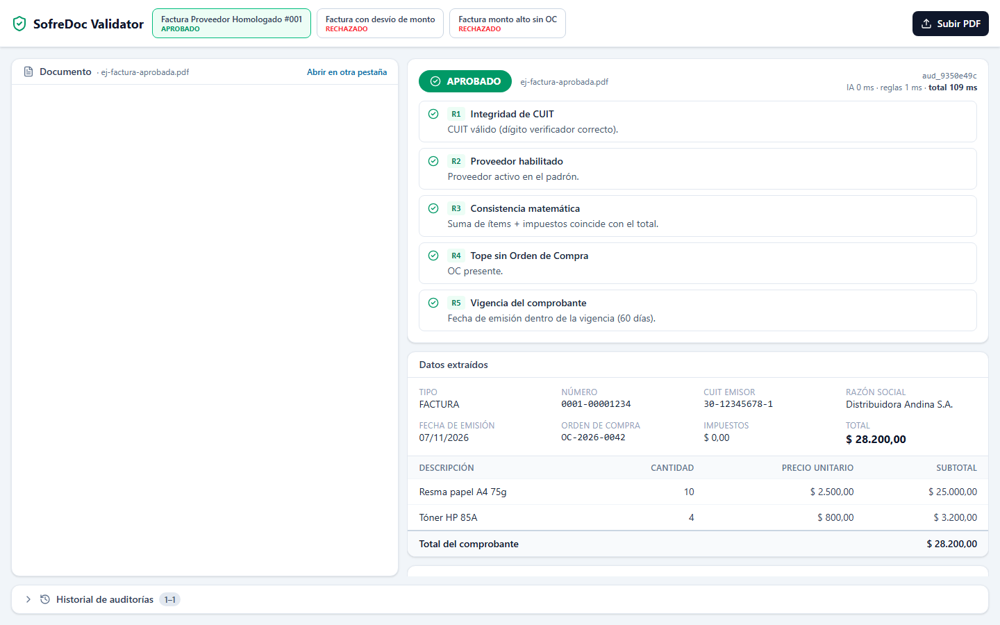
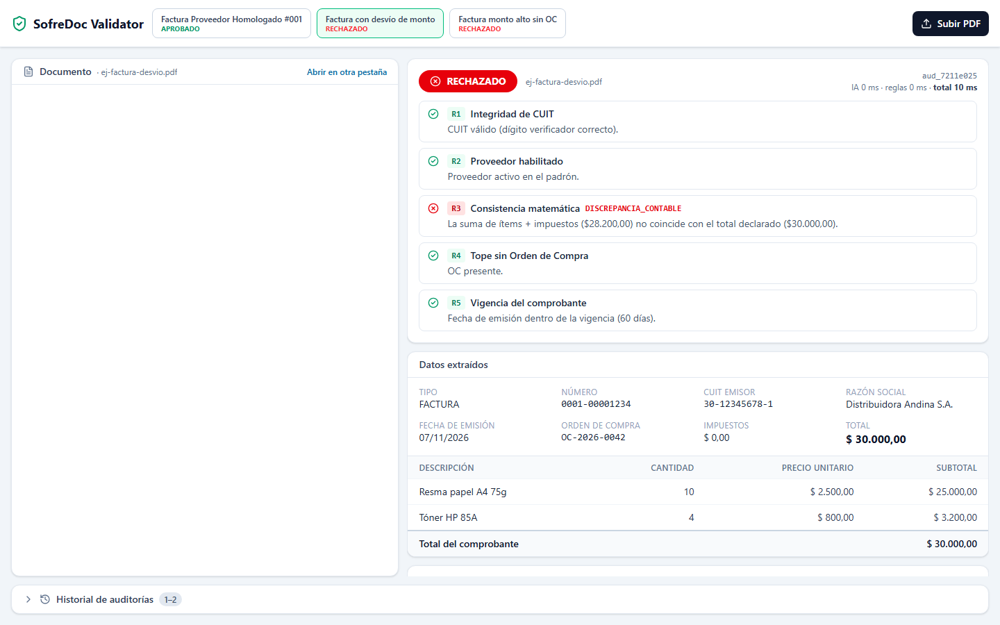
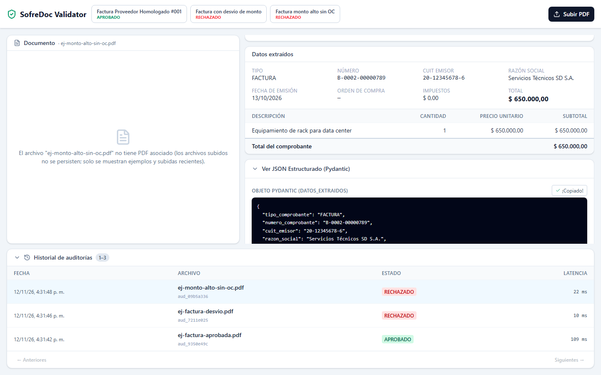

# SofreDoc Validator

Aplicación web **IDP** (Intelligent Document Processing) que audita facturas en PDF: un LLM extrae los datos (Structured Outputs) y un **motor de reglas determinista** (R0–R5) decide el semáforo ✅/❌. PoC fullstack de Sofre Digital S.A.

- **Backend:** Python 3.11+ · FastAPI · Pydantic v2 · SQLite (stdlib) — Clean Architecture
- **Frontend:** React 19 · TypeScript · Vite · Tailwind CSS v4
- **Fuente de verdad:** [`specs/`](./specs/README.md) (SDD) · estado del proyecto en [`specs/PROGRESO.md`](./specs/PROGRESO.md)

## Quickstart (2 comandos por terminal)

### 1. Backend — `http://localhost:8000`

```powershell
cd backend
python -m venv .venv
.\.venv\Scripts\Activate
pip install -r requirements.txt
uvicorn src.main:app --reload --port 8000
```

Salud del servicio: `GET http://localhost:8000/api/v1/health` → `{"status":"ok","version":"0.1.0","extractor_mode":"mock"}`

### 2. Frontend — `http://localhost:5173`

```powershell
cd frontend
npm install
npm run dev
```

El proxy de desarrollo redirige `/api` → `http://localhost:8000` (objetivo configurable con
`VITE_PROXY_TARGET`; útil para apuntar a otro backend, ej. el del E2E en `:8010`).

La pantalla dividida (MOD-04) es operativa: 3 ejemplos de 1 click + subida de PDF (≤ 5 MB) a la
izquierda el visor y a la derecha el semáforo R0–R5, los datos extraídos, el inspector de JSON
y el panel plegable de historial. Para desplegar el frontend (Vercel), definir
`VITE_API_URL=https://<backend>/api/v1`.

## Variables de entorno

Copiar `backend/.env.example` → `backend/.env` y `frontend/.env.example` → `frontend/.env` para personalizar. Los `.env` reales no se versionan.

| Variable (backend) | Default | Uso |
| :--- | :--- | :--- |
| `APP_ENV` | `dev` | Etiqueta de entorno/logging |
| `API_PORT` | `8000` | Puerto de uvicorn |
| `CORS_ORIGINS` | `http://localhost:5173` | Orígenes permitidos (separados por coma) |
| `DB_PATH` | `backend/data/sofredoc.db` | Archivo SQLite |
| `EXTRACTOR_MODE` | `mock` | `mock` \| `llm` (el modo `llm` requiere `LLM_API_KEY`) |
| `LLM_PROVIDER` | `openai` | Proveedor de extracción IA |
| `LLM_MODEL` | `gpt-4o-mini` | Modelo con Structured Outputs |
| `LLM_API_KEY` | *(vacía)* | Requerida solo si `EXTRACTOR_MODE=llm` |
| `PADRON_PATH` | `backend/data/proveedores.json` | Padrón de proveedores (R2) |
| `MAX_PDF_MB` | `5` | Tope de tamaño de subida |
| `TZ` | `America/Argentina/Buenos_Aires` | Zona horaria del reloj de negocio (R5) |

| Variable (frontend) | Default | Uso |
| :--- | :--- | :--- |
| `VITE_API_URL` | *(vacío → proxy `/api` de Vite)* | URL base de la API (producción, ej. Vercel → Render) |
| `VITE_PROXY_TARGET` | `http://localhost:8000` | Objetivo del proxy `/api` en desarrollo (ADR-05-09) |

## Calidad

```powershell
# Tests + gate de cobertura (desde la raíz; dominio 100%, total ≥ 95%)
backend\.venv\Scripts\python.exe -m pytest backend\tests -q --cov=src --cov-report=term-missing --cov-fail-under=95

# Lint + format (Python)
backend\.venv\Scripts\python.exe -m ruff check backend
backend\.venv\Scripts\python.exe -m ruff format backend

# Lint + build de producción (frontend)
cd frontend ; npm run lint ; npm run build

# E2E Playwright (levanta backend mock :8010 + frontend :5175 propios; 10 escenarios, retries 0)
npx playwright test qa/e2e/auditoria.spec.ts

# k6 saturación: rampa a 50 VUs (RN-5-01: SOLO con EXTRACTOR_MODE=mock)
k6 run qa/load/stress_test.js          # completa (~105 s)
$env:SMOKE="1" ; k6 run qa/load/stress_test.js   # smoke CI: 10 VUs × 30 s

# k6 funcional: contrato + matriz de verdad + errores bajo carga (pausa 1 s)
k6 run qa/load/funcional.js            # completa (~2 min)
$env:SMOKE="1" ; k6 run qa/load/funcional.js     # smoke CI (~30 s)
$env:ESCENARIO="matriz" ; k6 run qa/load/funcional.js ; $env:ESCENARIO=$null
```

Umbrales verificados (SLOs, detalle en `specs/modules/05-qa-testing/04-verification.md`):

| Métrica | Umbral | Obtenido |
| :--- | :--- | :--- |
| Tests Pytest (110) | < 30 s | **8.60 s** |
| Cobertura dominio / aplicación | 100% / > 90% | **100% / 100%** (total 99.59%) |
| E2E Playwright (10 escenarios) | 2 pasadas sin flakes | **10/10 passed × 2 pasadas** (última: 1.0 m) |
| k6 a 50 VUs: tasa de error | < 1% | **0.00%** |
| k6 a 50 VUs: latencia p95 | < 500 ms | **449.35 ms** |
| k6 funcional: checks de contenido | > 99% | **100%** (7008 requests, EXIT=0) |
| k6 funcional: latencia p95 | < 500 ms | **337.45 ms** |

Ver [qa/README.md](./qa/README.md) para la guía completa de QA.

## Capturas de la demo

Capturas reales generadas por la suite E2E (`CAPTURAS=1`, ver `qa/README.md`):


*Ejemplo #001: semáforo verde R1–R5 con desglose de latencia (IA / reglas / total), datos extraídos e inspector de JSON.*


*Ejemplo con desvío de monto: `RECHAZADO` por R3 (`DISCREPANCIA_CONTABLE`), el resto del semáforo en verde.*


*Inspector de JSON (objeto Pydantic + crudo IA, copiable) e historial con estado y latencias por auditoría.*

## Estructura

```text
backend/    # FastAPI monolito (Clean Architecture: domain / application / infrastructure / presentation)
frontend/   # React + Vite (espejo de capas: domain / application / infrastructure / presentation)
qa/         # Playwright e2e + k6 load (MOD-05)
specs/      # Especificaciones SDD (fuente de verdad)
```
